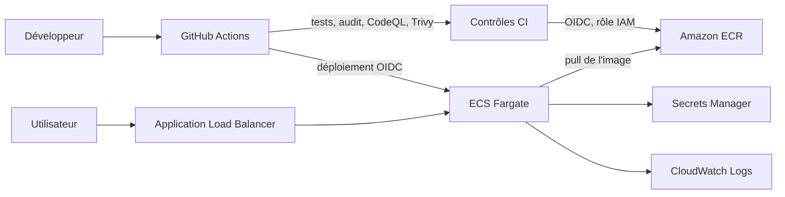

# devsecops-tp

API Express utilisée pour le TP de sécurisation CI/CD.

## Développement local

```bash
npm ci
npm test
npm start
```

L’API écoute sur le port `3000` par défaut. Le fichier `.env.example` ne contient aucun secret.

## Secrets et réponse à une fuite

Une clé AWS poussée dans Git doit être considérée comme compromise, même si elle a été supprimée dans un commit ultérieur : elle reste dans l’historique et a pu être copiée.

Dans l’ordre :

1. Révoquer immédiatement la clé dans AWS IAM.
2. Vérifier son utilisation dans CloudTrail et rechercher toute activité ou dépense suspecte.
3. Remplacer la clé si elle est encore nécessaire, avec les droits minimums, et la stocker dans un gestionnaire de secrets. Pour la CI, préférer OIDC quand c’est possible.
4. Purger la clé de l’historique Git, des branches et des tags, puis prévenir les collaborateurs que l’historique a été réécrit. Cette purge ne remplace jamais la révocation.
5. Activer la détection et le blocage des secrets pour éviter une nouvelle fuite.

## Protection des secrets GitHub

Secret scanning et push protection sont activés dans les paramètres du dépôt.


## Failles corrigées

Ces URL illustrent les failles présentes dans la version de départ. Elles ne doivent être utilisées que comme exemples : le serveur vulnérable ne doit jamais être exposé à Internet.

| Route | Faille | URL d’exploitation sur la version initiale | Correction |
|---|---|---|---|
| `/hello` | XSS réfléchie : le nom fourni est inséré sans échappement dans une page HTML. | `http://localhost:3000/hello?name=%3Cscript%3Ealert(1)%3C%2Fscript%3E` | Échapper les caractères spéciaux HTML avant l’affichage. |
| `/ping` | Injection de commande : `exec` interprète l’entrée utilisateur dans un shell. | `http://localhost:3000/ping?host=google.com%3Bcat%20%2Fetc%2Fpasswd` | Valider strictement l’hôte et appeler `execFile` avec des arguments séparés. |
| `/prefs` | Prototype pollution : `_.merge` fusionne récursivement les paramètres non fiables. | `http://localhost:3000/prefs?__proto__%5Badmin%5D=true` | Construire la réponse uniquement à partir des clés `theme` et `lang`. |

Les tests de régression correspondants sont dans `tests/security.test.js`.

### Alertes CodeQL sur la version initiale

Le premier scan du commit `9273752` a relevé ces alertes sur `main` :

| Règle | Fichier et ligne initiale | Gravité | Traitement |
|---|---|---|---|
| `js/reflected-xss` | `src/app.js:12` | Haute | Échappement HTML ajouté sur `/hello`. |
| `js/command-line-injection` | `src/app.js:17` | Critique | Validation de l’hôte et `execFile` sur `/ping`. |
| `js/missing-rate-limiting` | `src/app.js:16` | Haute | Limiteur ajouté sur `/ping` : 10 requêtes par minute. |

La prototype pollution de `/prefs` a été trouvée en lisant le code : CodeQL ne l’a pas signalée. La route ne fusionne désormais plus les paramètres avec `_.merge` et ne renvoie que `theme` et `lang`.

## Sécurité & coûts

### Contrôles automatiques

[](https://github.com/3a-1m/devsecops-tp/actions/workflows/ci.yml)
[](https://github.com/3a-1m/devsecops-tp/security/code-scanning)

Le dépôt active Secret Scanning, Push Protection, les alertes et mises à jour Dependabot, ainsi que CodeQL en configuration par défaut. La branche `main` exige une pull request et des contrôles verts.

### Audit des dépendances

| État | Total | Faibles | Modérées | Élevées | Critiques | `npm audit --audit-level=high` |
|---|---:|---:|---:|---:|---:|---|
| Départ, avant mise à jour | 28 | 7 | 16 | 5 | 0 | Échec |
| Après mise à jour et corrections | 20 | 4 | 16 | 0 | 0 | Réussi |

Les alertes qui restent proviennent de dépendances transitives de développement (Jest et son outillage). Elles sont de sévérité faible ou modérée ; Dependabot les surveille. L’API de production n’embarque que les dépendances nécessaires.

### Images Docker

Le workflow CI reconstruit l’image naïve à partir du commit de départ `1483edd`, mesure les deux images, teste `/health` dans le conteneur optimisé, puis scanne les images avec Trivy. Mesures obtenues le 4 novembre 2026 sur le runner GitHub ([job image](https://github.com/3a-1m/devsecops-tp/actions/runs/41841713032)). Les tailles sont les tailles Docker non compressées.

| Image | Taille | Couches | CVE HIGH | CVE CRITICAL |
|---|---:|---:|---:|---:|
| Naïve | 1,176,432,245 B (≈ 1,10 Gio) | 11 | 532 | 20 |
| Optimisée | 173,160,115 B (≈ 165,1 Mio) | 9 | 0 | 0 |

Le Dockerfile optimisé épingle Node `22.22.3-alpine3.24`, met à jour les paquets Alpine, supprime npm inutilisé à l’exécution, installe uniquement les dépendances de production dans une étape dédiée, n’intègre que `src/` dans l’image finale et exécute le serveur avec l’utilisateur non privilégié `node`. `.dockerignore` exclut notamment `.git`, `node_modules` et les fichiers `.env`. Dans le Dockerfile naïf de départ (`COPY . .` sans `.dockerignore`), un `.env` présent dans le contexte et le dossier `.git` seraient copiés dans l’image.

### Architecture et estimation AWS



Calcul pour une tâche de 0,25 vCPU et 0,5 Go, avec les prix fournis pour `us-east-1` :

| Scénario | Heures/mois | Calcul | Coût/mois |
|---|---:|---|---:|
| A. x86 en continu | 730 | `(0,25 × 0,04048 + 0,5 × 0,004445) × 730` | **9,01 $** |
| B. ARM en continu | 730 | `(0,25 × 0,03238 + 0,5 × 0,003556) × 730` | **7,21 $** |
| C. x86, 12 h × 5 j/semaine | 260 | `(0,25 × 0,04048 + 0,5 × 0,004445) × 260` | **3,21 $** |

Ces montants couvrent seulement le calcul Fargate. Ils excluent notamment l’ALB, le stockage ECR, les journaux et le transfert réseau.

Une NAT Gateway à `0,045 $/h` coûte `0,045 × 730 = 32,85 $/mois`, même sans trafic. Elle coûte environ 3,65 fois le calcul x86 du scénario A et ajoute 23,84 $ à ce coût de base. Pour une petite API, il faut donc justifier la NAT ou étudier une architecture avec endpoints privés et/ou accès sortant différent.

### Réponses aux questions

1. **Clé AWS publiée :** la révoquer immédiatement, examiner CloudTrail et la facturation, remplacer avec des droits minimums, purger ensuite l’historique Git et prévenir les collaborateurs. Préférer OIDC à une clé longue durée dans la CI ; effacer la clé d’un commit ne la révoque pas.
2. **Incident Trivy de mars 2026 :** l’advisory indique que les tags historiques sous `0.35.0` ont été détournés, sauf `0.35.0`. Le tag historique `@0.34.0` (sans `v`) était donc touché. Pendant la remédiation, les anciens tags ont été retirés et des tags `v` ont été republiés sur les commits sains ; le `@v0.34.0` ainsi republié est la référence corrigée. Un SHA ne protège que s’il désigne un commit vérifié et sûr : une ancienne épingle pouvait encore dépendre de `setup-trivy` compromis. Ce dépôt épingle le commit `ed142fd0673e97e23eac54620cfb913e5ce36c25` de `trivy-action` (`v0.36.0`). [Avis de sécurité Aqua/GitHub](https://github.com/aquasecurity/trivy/security/advisories/GHSA-69fq-xp46-6x23).
3. **NAT Gateway :** `32,85 $/mois` sans trafic, contre `9,01 $` pour Fargate x86 en continu. Le coût fixe de la NAT dépasse donc largement celui de la tâche ; il doit apparaître dans le budget avant le déploiement.

### Rétention ECR

La politique [aws/ecr-lifecycle.json](aws/ecr-lifecycle.json) conserve les 10 images les plus récentes.

### Bonus : déploiement OIDC

Le workflow [`deploy-aws.yml`](.github/workflows/deploy-aws.yml) reste inactif tant que `AWS_ENABLED` n’est pas défini à `true`. Pour l’activer, configurer les variables GitHub `AWS_ROLE_ARN`, `AWS_REGION`, `ECR_REPOSITORY`, `ECS_CLUSTER`, `ECS_SERVICE`, `ECS_EXECUTION_ROLE_ARN`, `ECS_TASK_ROLE_ARN` et `ECS_LOG_GROUP`, puis autoriser le dépôt et l’environnement `production` dans la relation de confiance OIDC du rôle IAM. Aucune clé AWS n’est enregistrée dans GitHub.
